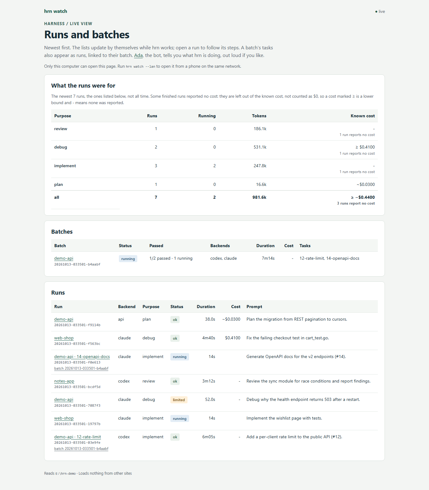
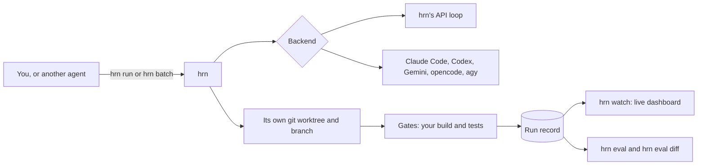

# hrn: run coding agents, keep every run, compare them

[](https://github.com/cristiangirlea/harness/actions/workflows/ci.yml)
[](https://github.com/cristiangirlea/harness/releases)
[](LICENSE)

**hrn** is one Go binary that hands a coding task to an agent (Claude Code, Codex, Gemini,
opencode, agy, or its own Anthropic API loop), saves everything that happened, and lets you
watch it live, replay it, run several in parallel, and score agents against each other.



## How a run works



1. **You give a task.** A prompt, from the command line or a batch file.
2. **hrn picks a backend.** Its own API loop, or an agent CLI you already have installed and
   signed in to. Each uses its own plan or credentials.
3. **The agent works in its own worktree.** A batch gives each task a separate git worktree on
   its own branch, so parallel agents never step on each other.
4. **Gates check the result.** Your build and tests run after the agent finishes. A failing gate
   can trigger a retry.
5. **Everything is recorded.** Prompts, tool calls, answers, tokens, cost and timing go to a run
   record on your disk. The record stays local; the agent's own requests still go to its provider.
6. **You review and compare.** Follow a run live, replay it, merge the branches that passed, or
   run the same task set across backends and models with `hrn eval` and diff the results.

## Try it in a minute

You need Go 1.26.4 or later, and at least one backend. Install hrn, then see which backends
it can use:

```bash
go install github.com/cristiangirlea/harness/cmd/hrn@latest
hrn backends
```

Run a read-only task in one of your projects:

```bash
cd path/to/your/project
hrn run -b codex --mode readonly "Explain this project and its main entry points."
```

Open the dashboard in another terminal, then go to **http://127.0.0.1:8089**:

```bash
hrn watch
```

It shows runs started through hrn, as they happen. For a tour of the pages, see
[hrn watch and Ada, in pictures](docs/presentation.md).

Prefer the terminal? `hrn runs` lists recent runs, `hrn show <run-id>` replays one, and
`hrn show -f <run-id>` follows a run live.

Backend setup, with each agent's login and what it costs, is in [backends](docs/backends.md).
Updating an existing install is `hrn update`; see [hrn update](docs/commands.md#hrn-update).

## What you can do

- **Run and revisit tasks.** Save prompts, tool calls, answers and usage. Continue a run on the
  same backend, or hand it to another.
- **Watch progress.** A built-in local dashboard shows runs, batches and tool calls as they happen.
- **Split work across agents.** Run a batch in separate git worktrees, with build and test gates
  and retries.
- **Compare results.** Evaluate backends and models against the same tasks and checks.
- **Connect through MCP.** Give the API loop any stdio MCP server's tools, or expose hrn itself
  as an MCP server so another agent can delegate work to it.

The Go code uses only the standard library. Agent CLIs are optional external programs: install
the ones you want.

## Where it fits

hrn is one part of a small set of AdaNext tools. Only the first two links below exist in code
today; the rest are planned, and each README says so.

| Repository | How it relates to hrn | Status |
|---|---|---|
| [hrn-evals](https://github.com/cristiangirlea/hrn-evals) | The eval suites hrn runs. Each suite is an `hrn eval` spec, and the diff between two runs is how a regression shows up. | In use |
| [harness](https://github.com/cristiangirlea/harness) (this repo) | The engine: runs, records, batches, evals, the dashboard. | In use |
| [adanext-exec](https://github.com/cristiangirlea/adanext-exec) | A planned gate every agent shell command goes through: policy, limits, and an audit log. Its README names hrn as a first user. | Being designed |
| [adanext-map](https://github.com/cristiangirlea/adanext-map) | A planned code map for agents. Its README says hrn will hand the map to every backend it runs. | Being built |
| [AdaNext OS](https://github.com/cristiangirlea/adanext-os) | The desktop workspace that runs an agent on a feature branch and brings back verified changes. | Early |

## Choose your next step

| I want to… | Read |
|---|---|
| Find commands, flags and budgets | [Command reference](docs/commands.md) |
| Choose a backend or continue a run | [Backends and continuation](docs/backends.md) |
| Understand what an agent is allowed to do | [Permissions and command guard](docs/permissions.md) |
| Connect hrn to an MCP host or tools | [MCP integration](docs/mcp.md) |
| Run parallel tasks and manage their branches | [Batches and worktree cleanup](docs/batches.md) |
| Reuse a few worktrees per repository instead of making new ones | [Reusable workspaces](docs/workspaces.md) |
| Use the dashboard, phone view or Ada bot | [Live dashboard and Ada](docs/watch.md) |
| See the dashboard and Ada in pictures | [hrn watch and Ada, in pictures](docs/presentation.md) |
| Score tasks or compare models | [Evaluations and reports](docs/evaluations.md) |
| Inspect or prune saved data | [Run records](docs/run-records.md) |
| Integrate hrn with a supervising program | [Exec protocol](docs/exec-protocol.md) |
| Find, write or verify a kept script | [Kept scripts](docs/scripts.md) |

## Permissions and privacy

Start with `--mode readonly` and read the [backend-specific permission
modes](docs/permissions.md#permission-modes). The command guard is a guardrail, not an
operating-system sandbox, and the same mode does not mean identical permissions on every backend.

Run records can contain source code, prompts and tool output, so treat the records folder as
you would the code itself. The dashboard listens on loopback by default. `--lan` lets anyone on
the selected network read the records without a login. With `--public`, the page is reachable
beyond loopback only through a Cloudflare Tunnel and Access application that you set up; see
[watch exposure](docs/watch.md#behind-cloudflare-access). Security boundaries and how to report a
vulnerability are in [SECURITY.md](SECURITY.md).

## Contributing

See [CONTRIBUTING.md](CONTRIBUTING.md) for source builds, checks, the repository layout and
releases. [PLAN.md](PLAN.md) records the work queue and past decisions.

## License

[MIT](LICENSE).
