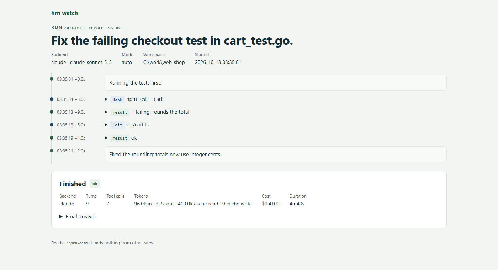
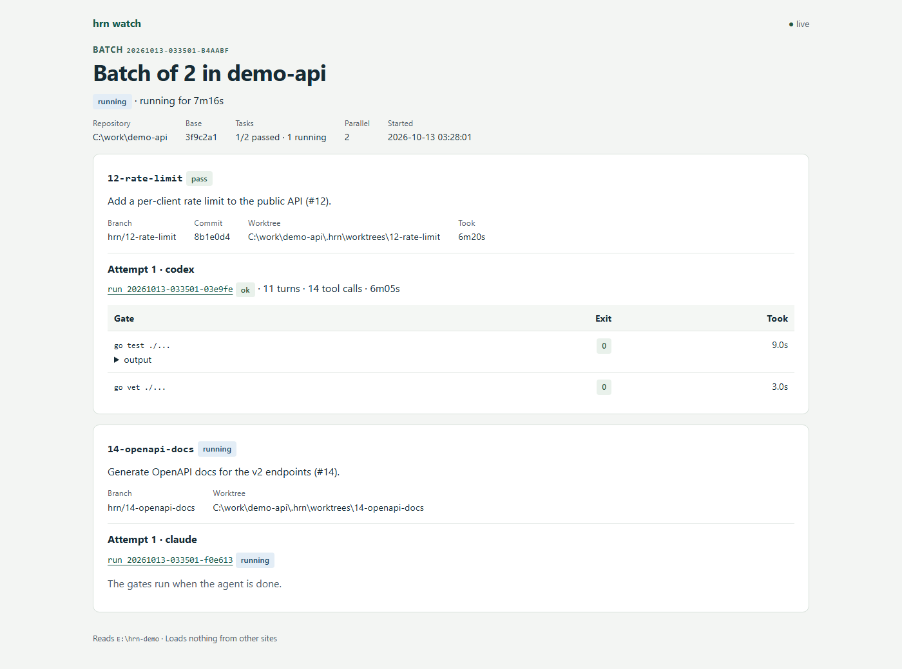
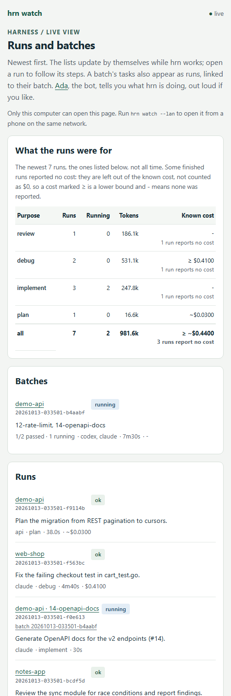
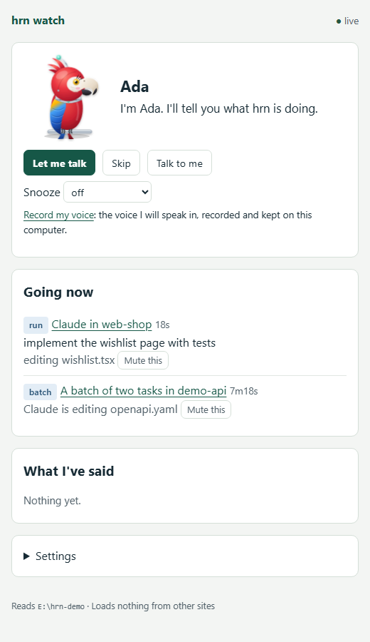

# hrn watch and Ada, in pictures

[← README](../README.md)

`hrn watch` is a live page of what hrn is doing, and Ada is its bot. These pictures were
taken from a scratch `HRN_HOME` filled with made-up runs and a made-up batch (the
`C:\work\...` repositories, prompts, commits and costs are all invented), so they show
no real work, paths or keys. How each page works is in [Live dashboard and Ada](watch.md).

## The index

Newest runs and batches, kept current while hrn works. Each row leads with its repository
(and, for a batch's run, its task), then the backend, what the run was for, its status,
duration and cost. "What the runs were for" sums the listed runs by purpose; a cost that
some backends did not report shows as a lower bound (`≥`) rather than counted as $0.

## A run

A run's timeline as it happens: the agent's text, each tool call and its result (folded),
how long each step waited, and, once it ends, its status, tokens, cost and final answer.

## A batch

Each task of a batch with its branch, worktree and attempts, a link to each attempt's run,
and the gates (command, exit code, output) as they finish.

## On a phone

With `hrn watch --lan`, a phone on the same network reads the same page; on a narrow
screen each run and batch becomes a small card.

## Ada

`hrn bot` opens Ada, a robot scarlet macaw, in a small window. She says what hrn is doing
in plain UK English: in a line at the top, a log, out loud and as notifications. "Going
now" lists what is running and what each agent is doing, with a Mute this for each.

